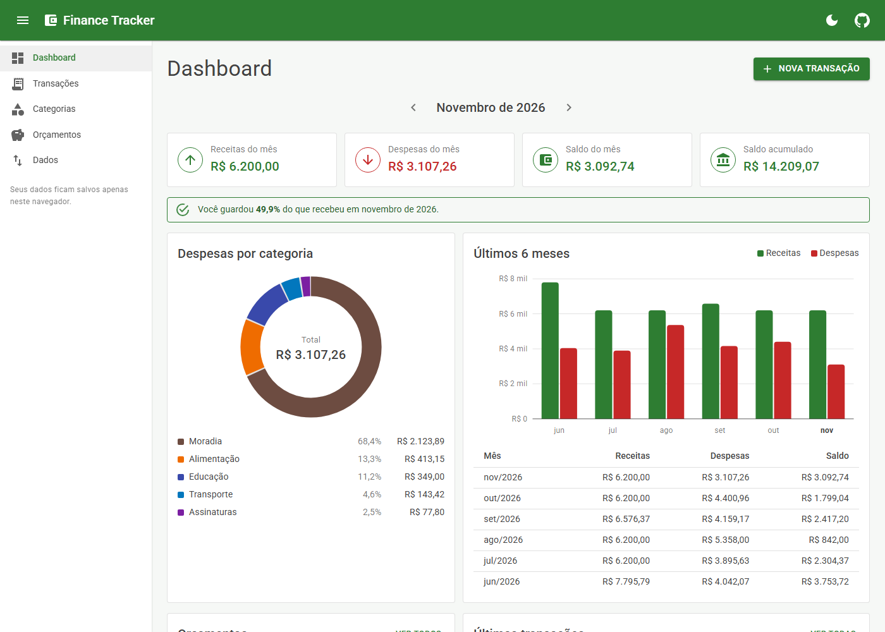
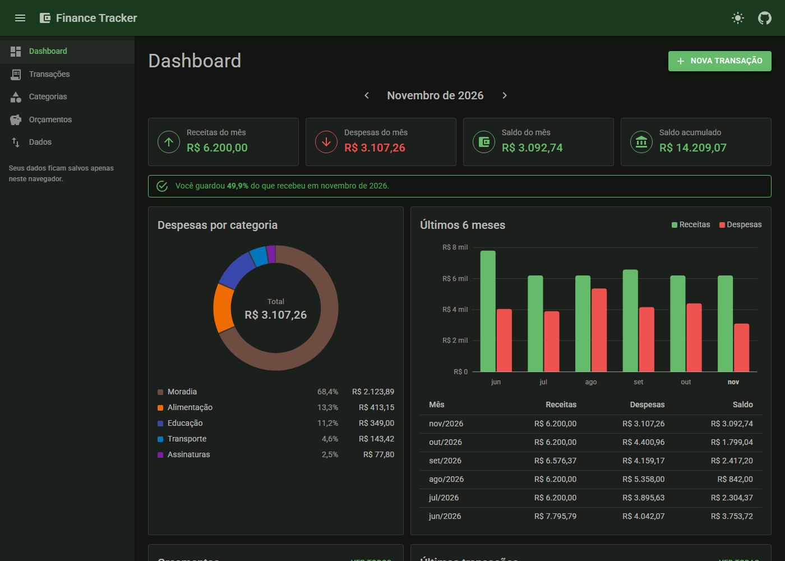
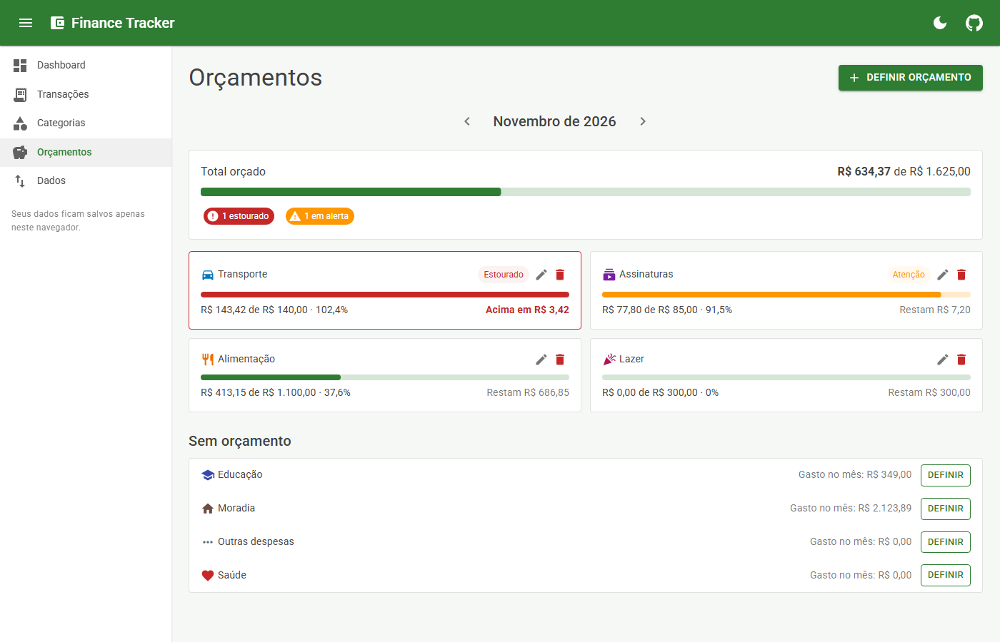
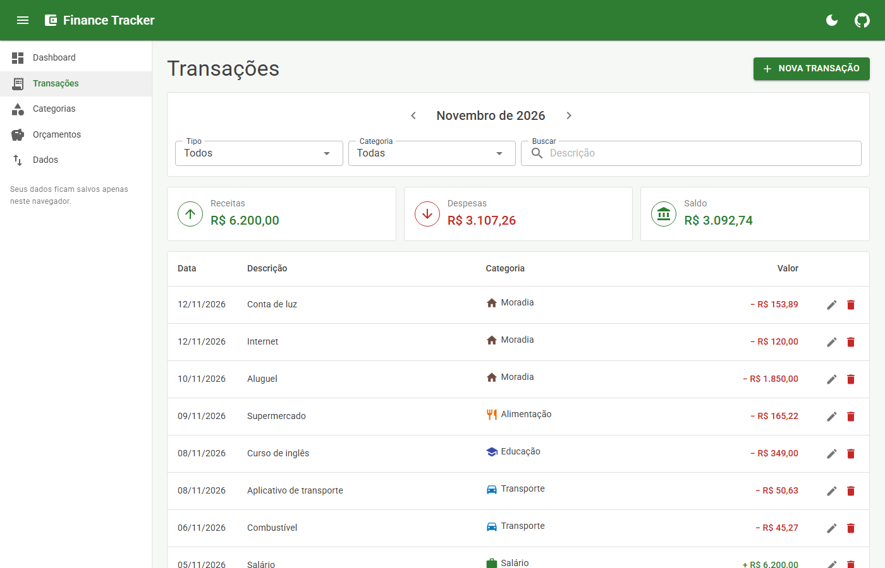
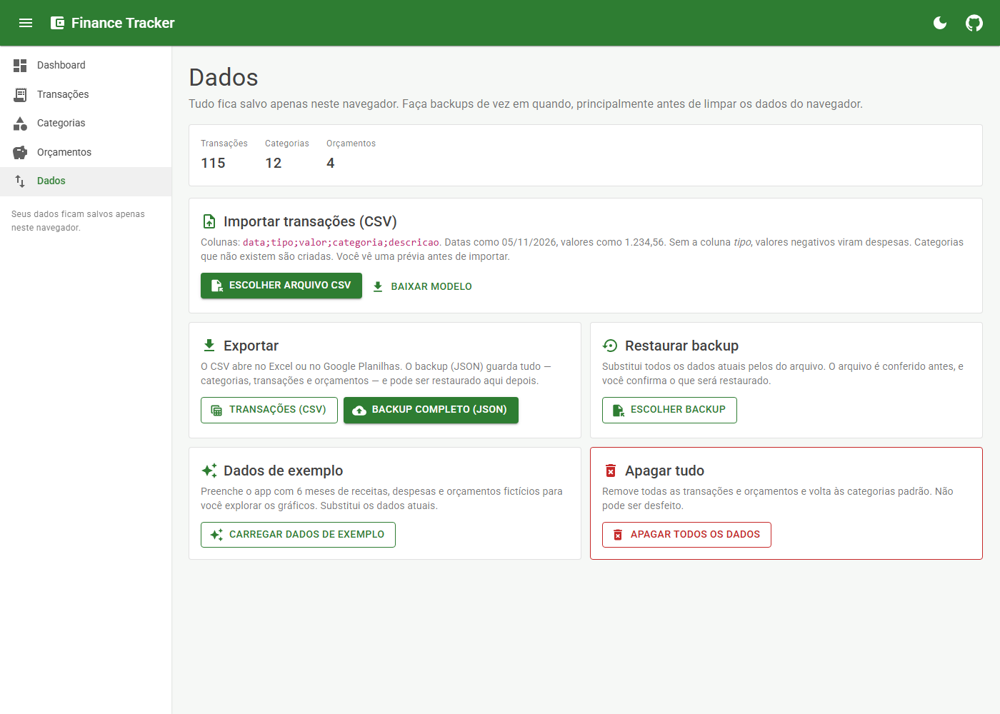
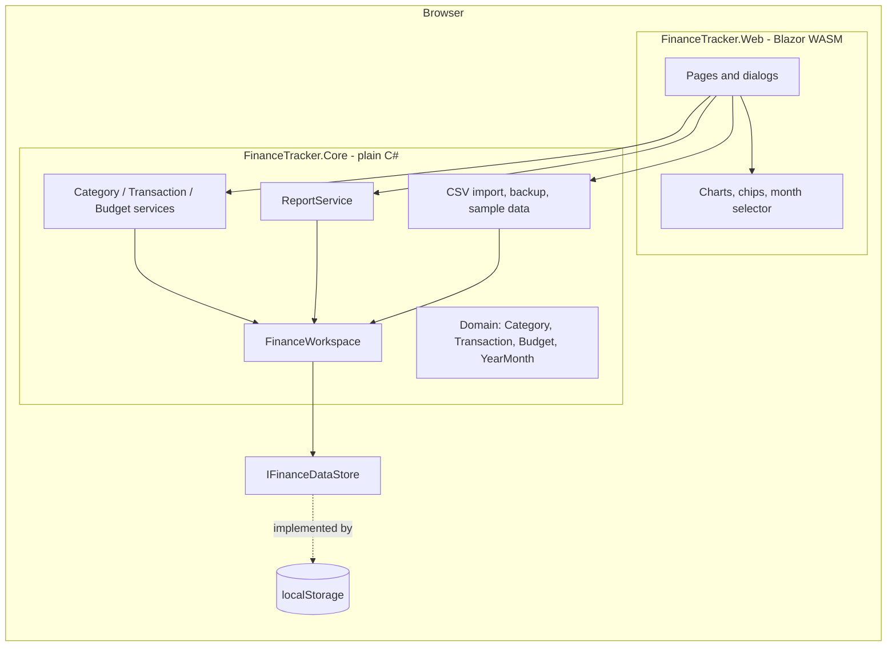

# Finance Tracker

[](https://github.com/Victor-Hugo-Oliveira/finance-tracker/actions/workflows/ci.yml)


A personal finance app (in Brazilian Portuguese) built with **Blazor WebAssembly** and **MudBlazor**.
Record income and expenses, organize them in categories, set monthly budgets and follow everything
on a dashboard with charts. It runs **entirely in the browser**: there is no server and no account,
and the data never leaves the user's device.

**▶ Live app:** https://victor-hugo-oliveira.github.io/finance-tracker/
&nbsp;·&nbsp; **[Open with sample data](https://victor-hugo-oliveira.github.io/finance-tracker/exemplo)** (fills six months of fictitious data, only if the browser has none)



| Dark mode | Budgets |
|---|---|
|  |  |

| Transactions | Data (import / export / backup) |
|---|---|
|  |  |

## Features

- **Transactions**: create, edit and delete income/expenses; filter by month, type and category; search that ignores accents (`cafe` finds `Café`)
- **Categories**: custom color (palette or color picker) and icon, live preview, archive/restore; categories in use can't be deleted, only archived, so history is kept
- **Budgets**: monthly limit per expense category, progress bars, **warning at 80%** and **exceeded** state with how much over
- **Dashboard**: month summary, savings rate, overall balance, **expenses-by-category donut**, **six-month income vs. expenses bars**, budget progress and latest transactions
- **CSV import** with a preview before saving: per-line errors, duplicate detection (re-importing the same file doesn't double anything), categories to be created. Accepts `;`/`,`/tab, Portuguese or English headers, `1.234,56` / `1234.56` / `R$` amounts, and Latin-1 files saved by Excel
- **CSV export** (opens correctly in Excel) and **full JSON backup / restore**; a restored file is validated before it replaces anything
- **Sample data** and **reset**, both with confirmation
- **Dark mode** that follows the system, with a toggle that remembers the choice
- **Brazilian formats** everywhere: `R$ 1.234,56`, `15/11/2026`, `Novembro de 2026`
- **Responsive**: tables turn into cards and charts adapt on phones

## Tech stack

| Area | Tools |
|---|---|
| UI | Blazor WebAssembly (.NET 10), MudBlazor 9 |
| Charts | Hand-written SVG components (no chart library) |
| Storage | Browser `localStorage`, one versioned JSON document |
| Tests | xUnit, bUnit, `FakeTimeProvider` |
| CI/CD | GitHub Actions → GitHub Pages |

## Architecture



| Project | Responsibility |
|---|---|
| `FinanceTracker.Core` | Domain entities and their rules, services, reports, CSV/backup. **No reference to Blazor or the browser**, so all business logic is tested with plain unit tests. |
| `FinanceTracker.Web` | Blazor pages, MudBlazor UI, SVG charts, `localStorage` adapter, file download/upload. |
| `FinanceTracker.Core.Tests` | 127 unit tests for rules, services, reports, CSV parsing, import and backup. |
| `FinanceTracker.Web.Tests` | 22 bUnit tests that render components and whole pages against the real services. |

### Design decisions

- **Money is always `decimal`**, limited to 2 decimal places by the domain. Report percentages are rounded so they always add up to exactly 100%.
- **The whole dataset is one JSON document with a `schemaVersion`.** That keeps saving atomic, makes backup the same format as storage, and leaves room for migrations.
- **Entities protect their own rules** (private setters, validation in constructors). Because JSON deserialization skips constructors, restored backups go through a validator that rebuilds every entity and checks references before anything is replaced.
- **Storage sits behind `IFinanceDataStore`.** Tests use an in-memory store that still round-trips through the real serializer, so serialization bugs show up in tests.
- **Time is injected (`TimeProvider`)**, so "this month" is deterministic in tests.
- **Unreadable stored data is never discarded**: it's copied aside under another key before the app starts fresh.
- **Charts are hand-written SVG** to control colors (each category keeps its own color in every month), tooltips, accessibility (`role="img"`, a table with the same numbers) and dark mode.

## Running locally

Requires the [.NET 10 SDK](https://dotnet.microsoft.com/download).

```bash
git clone https://github.com/Victor-Hugo-Oliveira/finance-tracker.git
cd finance-tracker
dotnet run --project src/FinanceTracker.Web
```

Open the URL printed in the terminal (e.g. `http://localhost:5151`). To try it with data, go to **Dados → Carregar dados de exemplo**, or open `/exemplo`.

Run all tests:

```bash
dotnet test
```

## Deployment

Every push to `main` runs [the CI workflow](.github/workflows/ci.yml): build, all tests, `dotnet publish`, then deploy to GitHub Pages.
Since a Blazor WebAssembly app is only static files, no server is needed. The workflow adapts the output for Pages:

- sets `<base href="/finance-tracker/">`, because the site lives under the repository path;
- copies `index.html` to `404.html`, so deep links like `/dados` load the app and its router picks the page;
- adds `.nojekyll`, otherwise Pages would drop the `_framework` and `_content` folders.

## Project structure

```
src/
  FinanceTracker.Core/
    Domain/        Category, Transaction, Budget, YearMonth, FinanceData
    Services/      CategoryService, TransactionService, BudgetService
    Reports/       ReportService (month summary, totals by category, trend)
    Transfer/      CSV reader/writer, ImportService, BackupService, validator, sample data
    Persistence/   IFinanceDataStore, serializer, FinanceWorkspace
  FinanceTracker.Web/
    Pages/         Dashboard, Transactions, Categories, Budgets, Data
    Components/    Charts (donut, trend), CategoryChip, MonthSelector, SummaryCard
    Services/      localStorage store, formats, file download/upload, theme preference
tests/
  FinanceTracker.Core.Tests/
  FinanceTracker.Web.Tests/
```

## Privacy

Everything is stored in the browser's `localStorage` on the user's own device. Nothing is sent to a server,
and nothing syncs between devices. Use **Dados → Backup completo** to keep a copy or move data to another browser.
